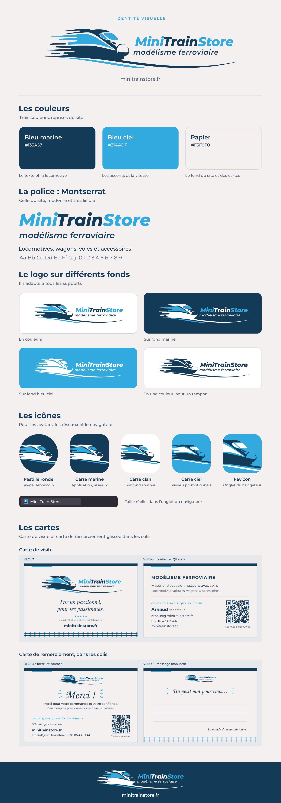

<h1 align="center"><a href="https://www.minitrainstore.fr/">Mini Train Store</a> : identité</h1>

Visual identity of [Mini Train Store](https://www.minitrainstore.fr/): logo, icon, business and shipping cards, category artwork, and the scripts that build their print-ready exports.

## Structure

- `ressources/planche-identite.png` ([SVG](ressources/planche-identite.svg)): the whole identity on one page, generated by `scripts/build_board.py`.
- `ressources/logo/`: logo and icon variants.
- `ressources/cartes-de-visite/`, `ressources/cartes-expedition/`: business and shipping cards (SVG sources, PDF for the printer, A4 sheets, previews). Read `LIRE-AVANT-IMPRESSION.txt` before printing.
- `ressources/categories/`: category line drawings, one livery colour per category.
- `scripts/`: `build_logo.py`, `build_card_sources.py`, `generate_cards.py` and `build_board.py`, run by the [card assets workflow](.github/workflows/card-assets.yml) on every change to regenerate the exports.

## Scripts

The Python dependencies are managed with [uv](https://docs.astral.sh/uv/) (`pyproject.toml`, `uv.lock`): `uv run scripts/<script>.py` installs them in `.venv` and runs the script. The scripts also need the Montserrat, DejaVu and URW base 35 fonts (Debian/Ubuntu: `fonts-montserrat fonts-dejavu-core fonts-urw-base35`).

The shop's colour palette (liveries of French rolling stock) is described in the shop's design documentation, in the private [boutique](https://github.com/MiniTrainStore/boutique) repository.

Part of the [espace-de-travail](https://github.com/MiniTrainStore/espace-de-travail) of Mini Train Store.

## About

All rights reserved to [Alix ANNERAUD](https://alix.anneraud.fr/).
