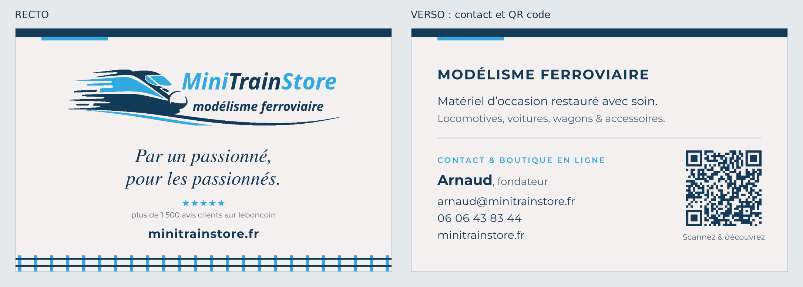

# Mini Train Store, carte de visite

Présenter la boutique et transmettre ses coordonnées, lors de rencontres, salons ou échanges.

## Design

Même système graphique que la [carte d’expédition](../cartes-expedition/) : couleurs du site (marine `#133a57`, bleu `#31aadf`, fond `#f5f0f0`), bandeau marine avec onglet bleu ciel, voie ferrée en pied de carte, Montserrat (police du site) pour les informations et Nimbus Roman Italic pour la devise.

- **Recto** : logo, devise du site « Par un passionné, pour les passionnés. », cinq étoiles et « plus de 1 500 avis clients sur leboncoin », adresse du site, voie ferrée.
- **Verso** : spécialité et offre, puis « Arnaud, fondateur », e-mail, téléphone et site à gauche, QR code à droite.

## Fichiers

- [PDF d’impression recto verso](minitrainstore-impression.pdf) : format fini 85 × 55 mm, fond perdu de 3 mm de chaque côté ; pages de 91 × 61 mm et TrimBox au format fini.
- [Planche A4 recto-verso, 8 cartes par face](minitrainstore-planche-A4.pdf) ([aperçu](minitrainstore-planche-A4-apercu.png)) et [planche A4 simple face, 4 paires](minitrainstore-planche-A4-simple-face.pdf) ([aperçu](minitrainstore-planche-A4-simple-face-apercu.png)) : même mode d’emploi que pour la [carte d’expédition](../cartes-expedition/README.md#impression-a4-simple-face-sans-imprimante-recto-verso).
- SVG vectoriels avec textes en tracés : [recto](minitrainstore-recto.svg) et [verso](minitrainstore-verso.svg).
- [Sources avec textes éditables](sources-editables/).
- [Kit complet ZIP](minitrainstore-kit-carte.zip).
- [Consignes d’impression](LIRE-AVANT-IMPRESSION.txt).

Imprimer à 100 %, sans ajustement automatique. Confirmer le profil couleur avec l’imprimeur : couleurs RVB, export non certifié PDF/X. Suggestion : papier mat 300 à 350 g/m².

Le QR code pointe vers https://www.minitrainstore.fr/?utm_source=carte-visite (suivi des scans dans le rapport UTM d’Umami). Coordonnées reprises de la boutique au 17 octobre 2026.

## Modifier la carte

La mise en page est décrite dans [`scripts/build_card_sources.py`](../../scripts/build_card_sources.py) (positions en millimètres, couleurs et polices partagées avec la carte d’expédition). Voir [Reproduire les exports](../cartes-expedition/README.md#reproduire-les-exports).
