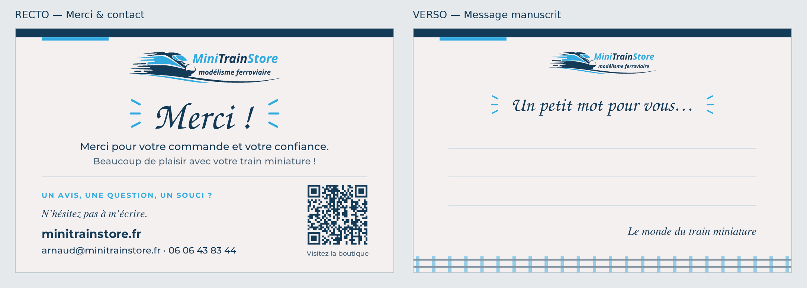

# Mini Train Store — Carte de remerciement pour les expéditions

Carte recto-verso à glisser dans les colis, en conservant le verso largement libre pour ajouter un message manuscrit.



## Design

Même système graphique que la [carte de visite](../cartes-de-visite/) : couleurs du site (marine `#133a57`, bleu `#31aadf`, fond `#f5f0f0`), bandeau marine avec onglet bleu ciel, voie ferrée, Montserrat (police du site) pour les informations, Nimbus Roman Italic pour les accroches et Z003 pour les titres manuscrits. Palette réduite au marine et au bleu ciel du logo.

- **Recto** : logo, grand « Merci ! », remerciement en deux lignes ; sous un filet, invitation à écrire (avis, question, souci), site, e-mail et téléphone à gauche, **QR code** vers https://www.minitrainstore.fr/?utm_source=carte-colis à droite (suivi des scans dans le rapport UTM d’Umami). Le texte est à la première personne, comme sur le site.
- **Verso** : petit logo, « Un petit mot pour vous… », trois lignes très légères pour écrire au stylo, signature « Le monde du train miniature » et voie ferrée estompée en pied de carte.

## Fichiers

- [SVG du recto](minitrainstore-recto.svg) et [SVG du verso](minitrainstore-verso.svg) : entièrement vectoriels, textes éditables. Copies identiques dans [sources-editables](sources-editables/).
- **[Planche A4 simple face — 4 paires recto/verso](minitrainstore-planche-A4-simple-face.pdf)** : **1 page A4**, 4 lignes de 2 panneaux (recto à gauche, verso à droite), avec 3 mm de fond perdu et des repères de coupe. [Aperçu](minitrainstore-planche-A4-simple-face-apercu.png). **Recommandée sans imprimante recto-verso**.
- **[Planche A4 recto-verso, 8 cartes par face](minitrainstore-planche-A4.pdf)** : 2 pages A4 portrait (2 colonnes × 4 rangées) avec fonds perdus, traits de coupe et rectos/versos alignés géométriquement. [Aperçu](minitrainstore-planche-A4-apercu.png).
- [PDF d'impression recto-verso](minitrainstore-impression.pdf) : 2 pages, format fini **85 × 55 mm**, fond perdu de **3 mm** de chaque côté et TrimBox au format fini.
- [Aperçu recto-verso](minitrainstore-apercu.png).
- [Kit complet ZIP](minitrainstore-kit-carte.zip).
- [Consignes d'impression](LIRE-AVANT-IMPRESSION.txt).

**Polices** : Montserrat, Nimbus Roman Italic et Z003 (paquets `fonts-montserrat` et `fonts-urw-base35`). Les SVG restent éditables, mais leur rendu typographique peut varier selon les polices installées ; le PDF garantit le rendu du tirage.

**Écriture** : papier mat non couché conseillé (300 à 350 g/m²), sans pelliculage ni vernis au verso. Le fond papier très clair reste compatible avec l'écriture ; faire un essai avec le stylo utilisé en boutique.

## Impression A4 simple face (sans imprimante recto-verso)

Imprimer **`minitrainstore-planche-A4-simple-face.pdf`** sur une seule face d'une feuille **A4 portrait, à 100 % / taille réelle**, sans mise à l'échelle. Chaque ligne contient un **recto à gauche** et un **verso à droite** : **4 paires par feuille**. Les traits fins situés hors des cartes indiquent où couper. Pour obtenir quatre cartes réellement recto-verso, découper les huit panneaux et **assembler chaque recto avec son verso dos à dos**, par exemple avec de l'adhésif double face. L'imprimante n'a pas besoin de gérer le duplex.

Vérifier un exemplaire imprimé avant la découpe en série : taille finale **85 × 55 mm par panneau**, marges imprimables et qualité du QR code.

## Variante pour imprimante recto-verso

Imprimer `minitrainstore-planche-A4.pdf` **à 100 % / taille réelle**, sur **papier A4 portrait**, en **recto-verso, retournement sur les bords longs**, sans option « ajuster à la page ». Page 1 = huit rectos ; page 2 = huit versos. Couper sur les **repères de découpe** (chaque carte finie mesure 85 × 55 mm). Les fonds perdus occupent 3 mm tout autour.

Les deux faces utilisent exactement la même grille centrée, mais les imprimantes domestiques peuvent introduire un décalage entre les faces. **Faire d'abord un test sur papier ordinaire** pour confirmer le retournement, le sens et l'alignement avant un tirage sur papier épais.

## Reproduire les exports

Les deux cartes (visite et expédition) sont décrites dans [`scripts/build_card_sources.py`](../../scripts/build_card_sources.py) : positions en millimètres, couleurs, polices, logo ([`ressources/logo-horizontal.svg`](../logo-horizontal.svg)) et QR code généré. Modifier ce script plutôt que les SVG, puis :

```sh
python -m pip install segno cairosvg pypdf pillow
python scripts/build_card_sources.py   # SVG maîtres des deux cartes
python scripts/generate_cards.py       # PDF, planches A4, aperçus et ZIP
```

Avec Inkscape installé, `build_card_sources.py` écrit aussi les SVG principaux de la carte de visite avec textes en tracés. Sous Debian/Ubuntu, installer `fonts-montserrat`, `fonts-dejavu-core` et `fonts-urw-base35` pour conserver les mêmes polices que l'export CI. La [GitHub Action](../../.github/workflows/card-assets.yml) régénère les exports des deux cartes après une modification des SVG ou des scripts.

Les coordonnées reprennent celles publiées par la boutique en octobre 2026. Les QR codes pointent vers l'URL officielle avec un paramètre `utm_source` propre à chaque carte (`carte-visite`, `carte-colis`), sans service de redirection : le rapport UTM d'Umami indique quelle carte amène des visites.
