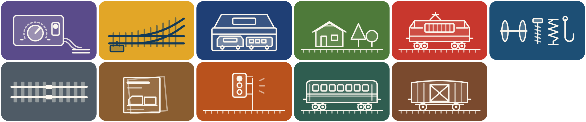

# Mini Train Store, dessins des catégories

Un dessin au trait par rayon de la boutique, dans l'esprit des anciennes planches techniques de la SNCF, et une couleur de livrée par rayon (le code couleur du site).



| Rayon | Fichiers | Couleur |
| --- | --- | --- |
| Locomotives | [trait](locomotives.svg), [tuile](locomotives-tuile.svg) | Rouge vermillon `#c8372d` |
| Wagons | [trait](wagons.svg), [tuile](wagons-tuile.svg) | Brun wagon `#7a4a2e` |
| Voitures | [trait](voitures.svg), [tuile](voitures-tuile.svg) | Vert 301 `#2f5d50` |
| Rails | [trait](rails.svg), [tuile](rails-tuile.svg) | Gris acier `#4f5b66` |
| Bifurcations | [trait](bifurcations.svg), [tuile](bifurcations-tuile.svg) | Jaune signal `#e2a627` (trait marine) |
| Coffrets | [trait](coffrets.svg), [tuile](coffrets-tuile.svg) | Bleu CIWL `#1f3f75` |
| Signalisation | [trait](signalisation.svg), [tuile](signalisation-tuile.svg) | Orange Corail `#b9521d` |
| Décor | [trait](decor.svg), [tuile](decor-tuile.svg) | Vert prairie `#4e7a3a` |
| Pièces détachées | [trait](pieces-detachees.svg), [tuile](pieces-detachees-tuile.svg) | Bleu atelier `#1d4f75` |
| Alimentations | [trait](alimentations.svg), [tuile](alimentations-tuile.svg) | Violet « Mistral » `#5a4b8a` |
| Revues | [trait](revues.svg), [tuile](revues-tuile.svg) | Sépia `#8a5d30` |

- `<rayon>.svg` : le dessin seul, trait marine sur fond transparent (impression, documents).
- `<rayon>-tuile.svg` : le dessin sur sa couleur de livrée, comme sur l'accueil du site.

## Régénérer

Les dessins vivent dans le code du site (`boutique/storefront/src/features/collections/category-art.tsx`) et les couleurs dans sa feuille de style. Ne pas retoucher ces SVG à la main : depuis `boutique/storefront`, lancer

```sh
npm run export:category-art
```

qui réécrit ce dossier, puis régénérer l'aperçu :

```sh
for f in *-tuile.svg; do magick -background none -density 60 "$f" "/tmp/${f%.svg}.png"; done
montage /tmp/*-tuile.png -tile 6x2 -geometry +4+4 apercu.png
```
