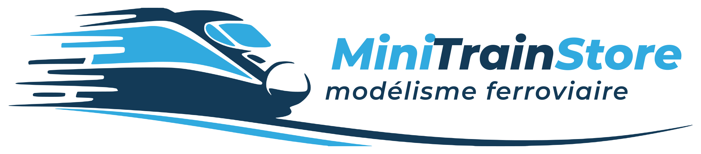

# Mini Train Store, logo



Locomotive retracée proprement en courbes vectorielles à partir du PNG d'origine (1050 px) : le dessin est inchangé, sans les marches d'escalier de l'ancien tracé. Le texte est composé en **Montserrat** (la police du site), avec ses vrais contours : ExtraBold Italic pour le nom, SemiBold Italic pour l'accroche.

Mise en page :
- les deux lignes suivent le même axe italique ;
- le bloc de texte est centré verticalement sur la locomotive ;
- la marge autour du nez est constante.

## Fichiers

| Fichier | Usage |
| --- | --- |
| [minitrainstore-logo.svg](minitrainstore-logo.svg) ([PNG](minitrainstore-logo.png)) | Logo principal, couleurs, fond transparent |
| [minitrainstore-logo-marine.svg](minitrainstore-logo-marine.svg) | Une couleur (marine) : tampon, impression une couleur |
| [minitrainstore-logo-blanc.svg](minitrainstore-logo-blanc.svg) | Tout blanc, sur photo ou fond foncé |
| [minitrainstore-logo-sur-marine.svg](minitrainstore-logo-sur-marine.svg) | Version couleur sur fond marine |
| [minitrainstore-locomotive.svg](minitrainstore-locomotive.svg) ([PNG](minitrainstore-locomotive.png)) | Symbole seul (locomotive entière) |
| [minitrainstore-locomotive-marine.svg](minitrainstore-locomotive-marine.svg) | Symbole seul, une couleur |
| [minitrainstore-icone-rond.svg](minitrainstore-icone-rond.svg) ([PNG 512 px](minitrainstore-icone-rond.png)) | Pastille ronde : avatar leboncoin, réseaux, sticker de colis |
| [locomotive.svg](locomotive.svg) | Source : tracé de la locomotive (ne pas retoucher à la main) |

Couleurs : marine `#133a57`, bleu ciel `#31aadf`.

## Régénérer

```sh
python -m pip install uharfbuzz fonttools cairosvg
python scripts/build_logo.py
```

Il faut installer Montserrat (`fonts-montserrat` sous Debian/Ubuntu). Les réglages de mise en page sont en tête de [`scripts/build_logo.py`](../../scripts/build_logo.py). Les cartes utilisent `minitrainstore-logo.svg` : relancer ensuite `scripts/build_card_sources.py` et `scripts/generate_cards.py`.
